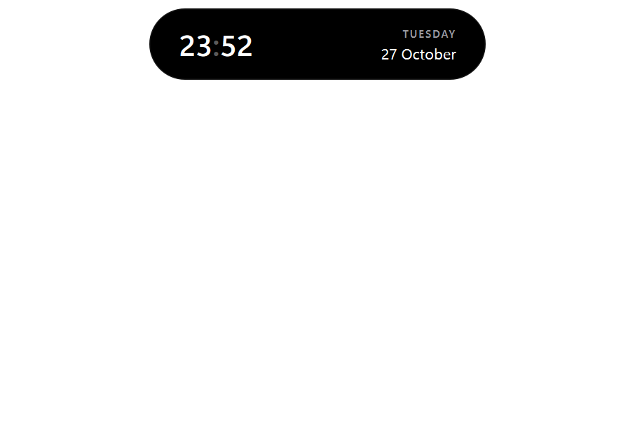
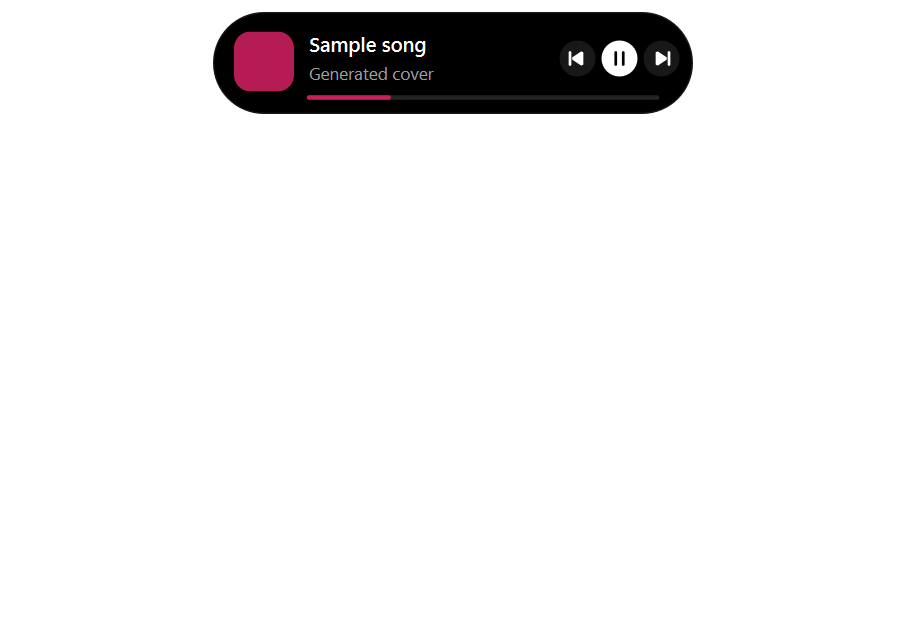
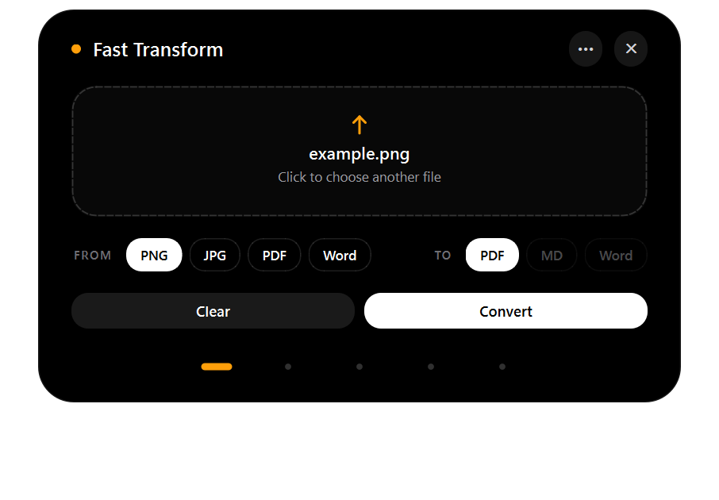
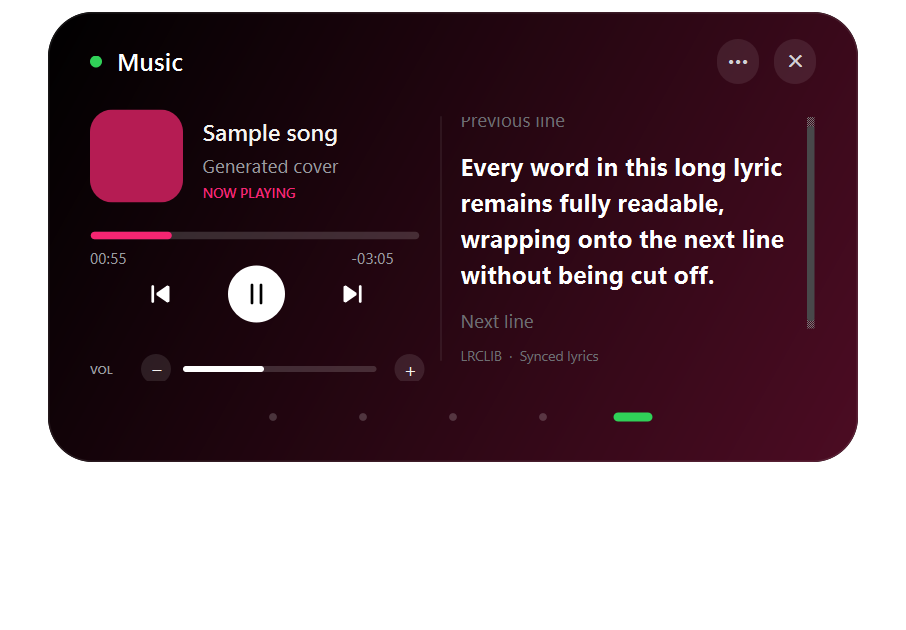
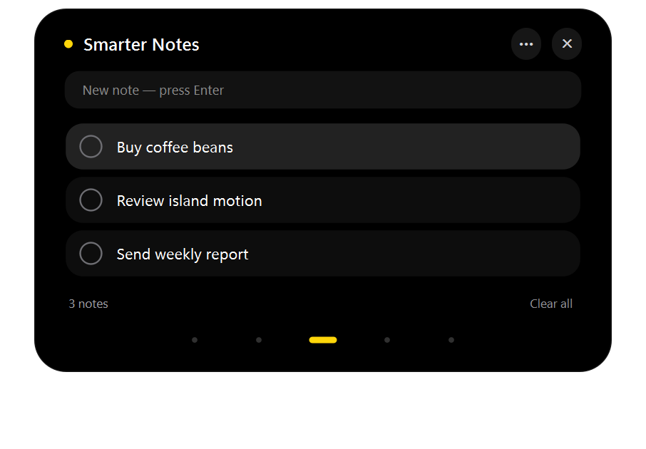
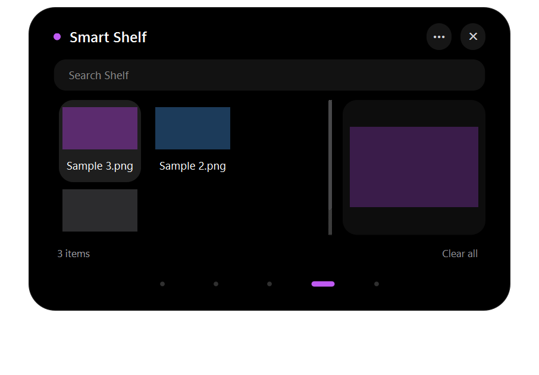
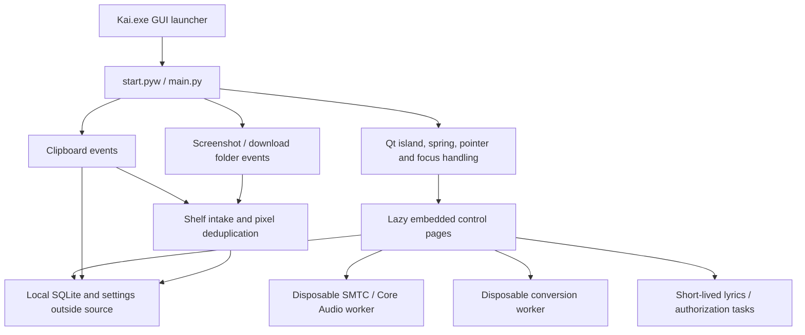

# Kai


**A native Windows Dynamic Island for clipboard history, quick notes, a smart file shelf, music, and focused file conversion.**

Kai lives at the top center of the desktop. It stays small until needed, expands near the pointer, and opens its controls inside the island. The aim is to make frequent desktop actions available without repeatedly opening a conventional application window.

Created by [RicoMitra](https://github.com/RicoMitra). Current application version: **4.0.0** (27 October 2026): a floating, iPhone-style Dynamic Island redesign with springy motion, pointer-aware eyes and Apple system accents. See [the 4.0 design spec](docs/20-kai-4-dynamic-island.md). The interface is English. Some development documents preserve the original Indonesian planning history.

**Status:** working local desktop prototype, with automated and native Windows checks. It is not a standalone installer, a Microsoft Store package, or a finished memory-constrained release. The requested **50 MiB maximum across every Kai process, including conversion, has not been proven**.

## Contents

- [Experience and visual design](#experience-and-visual-design)
- [Features](#features)
- [Install and launch](#install-and-launch)
- [Music and Spotify](#music-and-spotify)
- [Architecture](#architecture)
- [Memory engineering and evidence](#memory-engineering-and-evidence)
- [Privacy, security, and data](#privacy-security-and-data)
- [Verification](#verification)
- [Project map and documentation](#project-map-and-documentation)
- [Limitations and next work](#limitations-and-next-work)
- [Licensing and attribution](#licensing-and-attribution)

## Experience and visual design

Kai 4.0 adapts the iPhone Dynamic Island to a Windows pointer-and-keyboard workflow: one black capsule that changes shape with the task. It uses the installed **Segoe UI Variable** font and Apple system dark accents. It does not embed a browser or ship React, Electron, GSAP, or a webview. The full design reference is [docs/20-kai-4-dynamic-island.md](docs/20-kai-4-dynamic-island.md).

- **Collapsed:** a 72 × 24 DIP black pill with two vector-painted white eyes. The eyes follow the pointer, the pill leans in slightly as the pointer approaches, and the eyes blink every few seconds only while the island is idle.
- **Hover:** a 320 × 68 DIP capsule with a large clock (the colon breathes once a second) and the weekday and date. While media is known, it shows a live-activity card instead: cover, title, artist, progress and transport controls.
- **Floating capsule:** every state floats 8 DIP below the screen edge with fully rounded corners. The robot logo is used only as the application icon (Kai.exe, shortcut and tray), never inside the island.
- **Controls:** a 540 DIP wide panel. The header has only an accent dot, the page title, a **•••** menu and close. Page actions live in the ••• menu and in right-click menus, so the pages show content instead of rows of buttons.
- **Navigation:** five dots. The selected page has a marker in its accent colour (Transform orange, Clipboard blue, Notes yellow, Shelf purple, Music green) that blends colour and stretches while travelling. Tooltips, accessible names and Left/Right keyboard navigation remain.
- **Motion:** opening uses a slightly underdamped spring (width leads height) for a soft overshoot; closing is crisp and critically damped. Content fades and scales in, the panel is revealed like a curtain while the capsule morphs, and pages glide in from the direction of travel. Animation timers stop when settled. Reduce motion snaps everything and disables the eye motion.
- **Playback colour:** only the open Music page, while a track is playing, receives a dark gradient and a progress colour derived from its cover. There is no full-size background blur or native backdrop surface.
- **Behavior:** moving away closes the island after a short delay. Editing, an active dialog, or a popup keeps the controls available.

The screenshots below are generated acceptance fixtures rendered off-screen: the cover, song text, notes, and filenames are examples, not personal user content.

### Hover





### Fast Transform



### Music



### Notes



### Smart Shelf



## Features

Kai currently has five feature destinations and a separate Settings page.

| Destination | Purpose | Key behavior |
| --- | --- | --- |
| Fast Transform | Convert a file locally | Four approved workflows; one input and one result |
| Smart Clipboard | Reuse copied text and URLs | Search, filter, pin, copy/paste, pause, clear |
| Smarter Notes | Capture a short task or thought | Add, check, delete, pin; automatic saving |
| Smart Shelf | Gather files for the next action | Automatic intake, deduplication, thumbnails, preview, drag out |
| Music | Control an existing Windows media session | Previous/play-pause/next, seek, output volume, lyrics |
| Settings | Configure local options | Spotify client ID/login, clipboard history, media loading mode |

### Fast Transform

The interface separates **FROM** and **TO** with a center divider. Selecting PNG, JPG, PDF, or Word opens a matching native file picker. A file can also be dropped onto the page or sent from Shelf. Incompatible output choices are disabled.

Only these workflows are active:

| Source | Result | Implementation and fidelity |
| --- | --- | --- |
| PNG or JPG/JPEG | PDF | Places the image on an A4 PDF page, preserving its aspect ratio |
| PDF | Markdown (`.md`) | Extracts text; it does not reconstruct the complete original layout or semantic Markdown structure |
| PDF | Word (`.docx`) | Creates editable paragraphs from extracted text; it is not a layout-faithful PDF-to-Word engine |
| Word (`.docx`) | PDF | Recreates basic paragraphs, headings, tables, and embedded raster images; complex Word formatting can differ |

Legacy binary `.doc` files are not supported. Save them as `.docx` first. There is no PDF-to-JPG, general JPG output, Notes conversion, or MD/TXT input in the current interface.

Conversion runs in one disposable child process. Input is limited to one file of at most **20 MiB**. Images are checked against a **24-megapixel** ceiling and downsampled for conversion; decoder allocation limits can reject an image earlier. PDFs are limited to **50 pages**. Extracted text is limited to **200,000 characters**. DOCX ZIP contents are limited to **32 MiB**, its main XML to **4 MiB**, and embedded images to **eight**.

Text PDFs use their text layer. If a PDF contains no extractable text, Kai can use **local Windows OCR for up to two scanned pages**, using languages already installed in Windows. No OCR model is downloaded. OCR can make recognition mistakes and does not preserve the original page layout.

The parent interface receives result paths rather than full rendered images. **Save** copies the result to a chosen directory, avoiding filename overwrite, and clears the temporary job. **Clear**, leaving the page, closing the panel, or starting a new job also clears temporary results. Cancellation waits for the worker to finish or be reaped before deleting its scratch folder. Original inputs and copies deliberately saved by the user are preserved. A forced crash or power failure can leave temporary files behind.

### Smart Clipboard

Smart Clipboard stores **text and URLs only**. Code snippets remain text. It does not put screenshots, images, or copied files into text history; those are routed to Shelf.

- Event-driven capture with a short debounce, rather than continuous polling of clipboard contents.
- No import of the clipboard's initial contents on startup.
- Up to **80 history items**, **20 pinned items**, and **64 KiB of text per item**.
- Search; Enter or double-click pastes. Right-click an item to paste, copy, pin or delete it. The ••• menu filters text/links, pauses history and clears unpinned items.
- **Clear all** at the bottom deletes the whole history, including pinned items. The first click arms it (red, three seconds); a second click confirms.
- Paste targets the previous application through an explicit user action. Copy restoration is marked to avoid creating a duplicate history item.
- Honors supported password-manager and Windows clipboard-history exclusion hints. This is not a guarantee that every application marks sensitive content correctly.

Pausing text history does not disable Shelf's separate image/file intake.

### Smarter Notes

Notes deliberately uses one simple list. A **New note** field sits above the list; type the note and press Enter. Click the circle, or use Space on the selected item, to mark it complete. Hover a note and click its **×** to delete it, or use the Delete key, the right-click menu, or the ••• menu. Pin/unpin is in the right-click menu. **Clear all** (two clicks) deletes every note.

There is no search box, separate editor, detail screen, or additional note subheading. This follows the owner's preference to delete and recreate a mistyped note instead of maintaining an editing workflow. Pinned items stay above other items, and checking a note does not reorder it simply because its completion state changed.

Saving is debounced by **350 ms** and flushed on page/panel closure. Rows are drawn by a native item delegate rather than allocating a separate complex widget or blur effect for each note. Each note is limited to **20,000 characters**.

### Smart Shelf

Shelf is a temporary working collection of file references, not a second copy of the user's entire filesystem.

- Watches the Windows Known Folders for **new screenshots and completed downloads**. Files already present when the watcher starts are not bulk-imported.
- Receives copied images and copied file/folder paths from clipboard events; supports manually adding files or folders and dropping files into Shelf.
- Ignores common partial-download extensions and waits for file stability and writer completion.
- Computes a normalized pixel fingerprint to merge the same screenshot detected through clipboard and folder events. It prefers the original saved screenshot path and preserves pin metadata.
- Reconciles a bounded set of existing image references when Shelf first opens, repairing legacy duplicates.
- Displays actual bounded image thumbnails and an inline image preview. Other files show metadata and open with their default application after a user action.
- Supports search, multiple selection, and dragging file URLs into another application. Ctrl-click and Ctrl+A help select multiple items. Double-click opens an item; right-click opens, pins, converts or removes it. The ••• menu adds files or folders, filters by category and clears unpinned items.
- Remove, Clear unpinned and **Clear all** (two clicks) drop references only. Original user files on disk are never deleted.

Clipboard-origin PNG cache storage is bounded separately: **12 megapixels**, **4 MiB per PNG**, and **24 MiB total**. Only owned, unreferenced cache files are eligible for automatic purging. Deduplication hashes 64-row RGB32 strips to avoid a second full-size normalized bitmap. Thumbnail loading is limited to visible items, with a small bounded queue.

### Contextual actions

A valid copied web URL can offer **Open in Browser**. A captured image or added file can offer **View in Shelf**. These appear as short mini-island notifications, normally 290 × 56 DIP.

The prompt does not take keyboard focus or replace an embedded page while the user is working. Opening a browser requires a click; only validated HTTP/HTTPS targets are eligible. The mini island is feedback and an optional action, not a notification inbox or a background automation engine.

### Music

The Music page controls an existing Windows media session through **SMTC** and system output audio through **Core Audio**.

- Track title, artist, small artwork, duration, elapsed and remaining time.
- Previous, play/pause, and next controls.
- Click the progress bar to seek backward or forward to the chosen position, when the player exposes a valid timeline and accepts seeking.
- Output-volume buttons in **5% steps**, a click/drag volume rail, and mute. This is system output volume, not Spotify-only volume.
- Optional lyrics from **LRCLIB**, synchronized when timestamped lyrics are available.
- Long active lyrics wrap without ellipsis. A scrollbar and mouse wheel expose content that exceeds the viewport; adjacent lines can scroll out of view.
- A dark static album-derived background only during playback in this page.

Media/audio libraries live in an on-demand worker and are released when Music closes. Automatic volume/headset popups are not kept running outside Music. Actual player support varies; passing a widget test does not prove that every Spotify/device combination accepts every command.

## Install and launch

### Requirements

- A Windows desktop environment. Windows-specific clipboard, media, audio, hotkey, and launch behavior are not cross-platform features.
- **64-bit Python 3.12**, with the Windows `py` launcher. The recorded development runtime is **Python 3.12.4**.
- The pinned packages in [kai/requirements.txt](kai/requirements.txt), including **PySide6 6.10.1**.
- An internet connection for initial dependency installation. Optional Spotify login and uncached lyrics also need the network.

No speech model, microphone setup, Ollama, LLM server, Node.js, browser engine, or paid UI component is required.

### First run

1. Clone this private repository using an account with access:

   ```powershell
   git clone https://github.com/RicoMitra/Kai.git
   cd Kai
   ```

2. Run **Setup Kai.cmd** once. It creates the Python environment under `%LOCALAPPDATA%\Kai\runtime` and installs the pinned requirements outside the source folder.
3. Double-click **Kai.exe**. Daily use does not require a command window.
4. Move the pointer toward the island to expand it. Click to open controls, or use **Ctrl+Alt+Space** to open Fast Transform. Hover the footer dots to identify destinations; the ••• menu holds page actions and Settings. Escape closes the controls; the tray menu includes Quit Kai and Reduce motion.

`Kai.exe` is a small Windows GUI launcher, **not a self-contained Python/Qt bundle**. Copying that EXE alone is insufficient: keep the complete project folder and install the runtime first. The checked-in launcher is accompanied by [its C# source](tools/KaiLauncher.cs).

Optional developer launch:

```powershell
& "$env:LOCALAPPDATA\Kai\runtime\Scripts\python.exe" -B kai/main.py --island
```

Compatibility commands remain: `Kai.cmd`, `Kai Hemat.cmd` (forces media on demand), and `Kai Preview.cmd` (demo). `tools/create_shortcut.py` can create the Desktop shortcut when deliberately requested. Setup does not create a standalone installer or automatically enable Windows startup.

### Runtime and launcher troubleshooting

If the runtime is missing, run Setup rather than pressing a launcher prompt repeatedly. If files are stored in OneDrive, ensure the project files are available locally. The launcher can be checked without opening a dialog:

```powershell
.\Kai.exe --check
```

Setup launched inside a packaged Codex/MSIX environment can be redirected into that package's `LocalCache\Local\Kai` directory. The launcher has a physical fallback for this case and keeps the existing data directory consistent. Launching successfully from a developer terminal is not sufficient proof of Explorer/taskbar behavior. See [the running guide](docs/14-panduan-pakai.md) and [verification status](docs/07-status-dan-verifikasi.md). Do not delete a package cache containing user data as a shortcut to fixing a path problem.

## Music and Spotify

For ordinary media controls, open Spotify or another player, start playback there, and open Music in Kai. Basic SMTC controls use the existing Windows session and do not require entering a Spotify client ID into Kai.

Settings also exposes optional **Spotify PKCE authorization**. Register an application in the Spotify developer dashboard, use the configured callback `http://127.0.0.1:8888/callback`, enter the client ID locally, save it, and use Login Spotify. Kai does not require a client secret. Keep tokens out of chat, commits, and screenshots.

The existence of legacy Spotify action functions does not make track search, library browsing, or voice playback active UI features. Current Music support is the session-control interface described above. Spotify Web API access is subject to Spotify's account/API requirements. The owner's actual login, account playback mutations, and physical device combinations have not all been verified by the automated fixtures.

Lyrics requests send track metadata to LRCLIB. A bounded disk cache retains up to 50 tracks; lyrics are not bundled into the source repository. An exact lookup is followed by at most one search when LRCLIB returns 404. The fallback requires a matching normalized title/artist and duration within two seconds when supplied; it does not silently substitute a live version or another artist. Missing catalog entries show **Lyrics unavailable**, instrumental tracks have their own state, and network/service failures show a retry message. Missing results expire after six hours; transient failures back off for one minute. The cache survives reopen without keeping the full catalog in RAM, and damaged cache files are refetched. New songs can remain unavailable until the catalog contains them. Plain lyrics are labeled separately from synchronized lyrics. See [LRCLIB API documentation](https://lrclib.net/docs).

## Architecture



The native window uses a fixed canvas while the painted island morphs inside it, reducing repeated native-window resizing. Input regions are updated with the shape. The launcher, Qt GUI, and optional child workers are different processes and must all be considered when measuring memory.

| Module | Responsibility |
| --- | --- |
| `kai/island.py` | Window shape, spring, hover, tray, contextual state, embedded panel integration |
| `kai/panel.py` | Lazy page creation, task lifecycle, cancellation, worker coordination |
| `kai/widgets.py` | Painted media controls, wrapped lyric layout, white line navigation |
| `kai/product_pages.py` | Clipboard, Notes, Shelf, and Transform page widgets |
| `kai/storage.py` | SQLite schema/migrations, queries, local settings and paths |
| `kai/clipboard_service.py` | Event-driven text history, exclusions, routes to Shelf |
| `kai/capture_shelf.py` | Known Folder watching, stable-file intake, deduplication/cache ownership |
| `kai/desktop_worker.py`, `kai/native.py` | Media/audio process and Windows integrations |
| `kai/tasks.py`, `kai/transform.py` | Disposable work, conversion engines, bounded extraction/OCR |
| `kai/integrations.py` | Optional services such as active lyrics and historical integrations |
| `tools/KaiLauncher.cs` | GUI launcher, runtime resolution, diagnostics |

SQLite tables for older features and archived source modules remain for history and compatibility. Their presence does not mean those services start. Voice, WhatsApp, system monitoring, focus/Pomodoro, timers/alarms, weather, agenda/calendar, and Quick Command are **not active product destinations**. The displayed clock remains intentional even though the old time-management feature was removed.

## Memory engineering and evidence

The target is **at most 50 MiB across every Kai process combined, even during conversion**. It remains **unachieved as a verified hard ceiling**. A small working set under memory pressure is not proof of low allocation or a maximum for arbitrary inputs.

Historical whole-tree measurements from **23 October 2026**:

| Scenario | Private committed memory | Private working set | Interpretation |
| --- | ---: | ---: | --- |
| Cold idle | 30.31 MiB median | 1.12 MiB median | Very low resident result reflects paging; not a 1 MiB application footprint |
| After visiting and closing all six pages | 37.88 MiB median | 1.58 MiB median | Short idle-recovery sample, not a long soak |
| Active media/conversion scenario including scanned-PDF OCR | 93.41 MiB sampled peak | 23.33 MiB sampled peak | Combined process tree; the strict budget is not established |

The active run's total working-set sampled peak was **39.39 MiB**. It sampled every **100 ms**, observed up to **three simultaneous processes**, and used generated 1600 × 900 images and one-page PDFs. The measurement harness was excluded; the GUI/redirector and descendants were included. Sampling may miss shorter peaks. Results exclude DWM/system costs and are not an all-file guarantee. The 24 October eye/navigation refinement has not received a new whole-tree benchmark.

Optimizations already present:

- Native Qt painting; no web runtime, full-size backdrop blur, or continuously animated idle background.
- Animation timers stop when settled; the clock updates only where useful.
- Lazy pages, native row delegates, a 512 KiB QPixmapCache setting, bounded thumbnails and artwork.
- Event-driven clipboard/folder intake and bounded text/image caches.
- One conversion at a time, path-based results, cancellation/reaping and scratch cleanup.
- Media/audio on demand; conversion waits for retiring media workers rather than stacking them.
- Lyrics work is canceled on leaving Music.
- PDF extraction uses a QCoreApplication worker; GUI text-layout resources are reserved for conversions that need them.

Image decoding, PDF rendering, document layout, and Windows OCR can still raise peaks. No forced working-set trimming, paging trick, or terminate-on-budget policy is used to make the application appear to meet its target. Raw evidence is linked from [the current status](docs/07-status-dan-verifikasi.md) and [memory research](docs/12-riset-dan-anggaran-memori.md).

## Privacy, security, and data

Kai is a local desktop application, not a hosted SaaS service. It has no general upload endpoint, multi-user database API, or public login server.

| Data | Default location/behavior |
| --- | --- |
| Notes, clipboard history, Shelf references | `%LOCALAPPDATA%\Kai\kai.sqlite3` |
| Settings | `%LOCALAPPDATA%\Kai\settings.json` |
| Optional Spotify OAuth cache | `%LOCALAPPDATA%\Kai\spotify-token.json` |
| Owned clipboard images | `%LOCALAPPDATA%\Kai\clipboard-images` |
| Conversion scratch | `%LOCALAPPDATA%\Kai\transform-temp\job-*` |
| Lyrics cache and diagnostic logs | Subdirectories under the same local Kai data root |

MSIX redirection can change the physical path as described above. User data stays outside the source/OneDrive project and is excluded from Git. Shelf normally keeps references to originals; user-saved conversion results go to the chosen folder.

**Important current limitation:** the SQLite database, settings, and OAuth cache are local files; this version does not implement application-level encryption at rest. Do not describe them as encrypted or as protected from another process running under the same Windows account. Clipboard exclusions are best-effort signals, not a complete password-detection system.

Conversion text is not sent to an AI/cloud service. Windows OCR runs locally. Uncached lyric requests and optional Spotify authorization use external services. There is no microphone capture, active speech model, WhatsApp notification permission, or application analytics/telemetry pipeline in the active desktop flow.

The publication applies the owner's privacy guidance to secrets, repository contents, parameterized SQL, input limits, escaped document text, URL validation and dependency scanning. Web-only controls such as session cookies and row-level security do not apply to the current architecture. See [SECURITY.md](SECURITY.md) and [the publication review](docs/19-github-and-privacy.md) for scope, evidence, and unresolved work. A private repository is an access setting, not a substitute for these controls.

## Verification

The Kai 4.0 revision passed **45 unit tests**, including the underdamped spring, floating capsule geometry, white eye pixels, accent navigation, note hover-delete and lyrics wrapping. `tools/check_appearance.py` renders owned widgets off-screen without moving the pointer. The native pointer checks below move the real mouse and briefly show windows; run them only when the desktop is free. They were not rerun after the final 4.0 motion change. Earlier native checks covered stationary-pointer navigation, clipboard/Shelf behavior and conversion cleanup. Six generated conversion cases exercise the four supported workflows, including a scanned PDF and local Windows OCR.

Run checks sequentially to avoid overlapping GUI windows and workers:

```powershell
$kaiPython = "$env:LOCALAPPDATA\Kai\runtime\Scripts\python.exe"
& $kaiPython -B -m unittest discover -s kai -p 'test_*.py' -v
& $kaiPython -B tools/check_appearance.py
& $kaiPython -B tools/check_navigation.py
& $kaiPython -B tools/check_transform.py
& $kaiPython -B tools/check_shelf_v3.py
```

Native focus/input and worker checks:

```powershell
& $kaiPython -B tools/check_island_windows.py
& $kaiPython -B tools/check_controls_windows.py
& $kaiPython -B tools/check_desktop_worker.py
& $kaiPython -B tools/check_launcher.py
```

Memory measurements, also sequential:

```powershell
& $kaiPython -B tools/measure_ui_memory.py --mode core
& $kaiPython -B tools/measure_ui_memory.py --mode demand --panel-cycle
& $kaiPython -B tools/measure_active_memory.py
```

These scripts use generated fixtures and temporary stores where documented. Native checks can briefly show owned test windows and move the pointer. Actual Spotify account playback, every physical device, sleep/resume, prolonged soak behavior, arbitrary complex documents, and all monitor/DPI combinations are not established by these results. Historical reports are not silently relabeled as new benchmarks.

## Project map and documentation

```text
Kai/
├── Kai.exe                   GUI launcher; requires source folder + runtime
├── Setup Kai.cmd             Local runtime/dependency installation
├── kai/                      Active application, tests and historical modules
├── assets/                   Owner-provided robot identity and icon sizes
├── tools/                    Checks, benchmarks, builders, launcher source
├── docs/                     Design decisions, status, architecture and history
├── artifacts/                Selected generated screenshots and evidence
├── README.md                 Generated from docs/readme-source.md
├── SECURITY.md               Current security model and reporting guidance
├── THIRD_PARTY_NOTICES.md     Dependency/licensing notes
└── handoff.md                Generated complete Markdown/file inventory
```

Start with [the documentation index](docs/README.md), [current status](docs/07-status-dan-verifikasi.md), [latest subsystem contract](docs/18-notes-transform-dan-musik.md), and [complete handoff](handoff.md). The original [idea document](kai-dynamic-island.md) is preserved. Current decisions override historical proposals; old feature descriptions do not authorize reactivating them.

Original ZIP archives, owner reference photos, runtime/model files, caches, personal databases and credentials are not committed. Some historical documents refer to local-only references or owner-specific development paths. The README screenshots are generated fixtures included deliberately.

Documentation is reproducible:

```powershell
& $kaiPython -B tools/build_readme.py
& $kaiPython -B tools/build_readme.py --check
& $kaiPython -B tools/build_handoff.py
& $kaiPython -B tools/build_handoff.py --check
& $kaiPython -B tools/build_release.py
```

Edit [docs/readme-source.md](docs/readme-source.md) and [docs/handoff-source.md](docs/handoff-source.md), then regenerate their outputs. The release builder uses an allowlist and verifies archive hashes. It creates a source ZIP, not an installer; review its local reference-material policy before sharing a generated archive beyond the private development context. The checked-in launcher can be rebuilt with `tools/build_launcher.py` using the Windows .NET Framework C# compiler.

## Limitations and next work

1. **Memory:** establish a real combined-process peak budget, including OCR/large files and sustained use. The 50 MiB hard maximum is not achieved merely by reducing concurrency.
2. **Data protection:** design and validate at-rest protection for sensitive local history and OAuth material, including migration/recovery. Do not silently lose existing user data during a security change.
3. **Document fidelity:** Word conversion is basic layout reconstruction; PDF extraction is editable text rather than full document reconstruction.
4. **Packaging:** provide a separately validated standalone installation/distribution workflow if required. The current launcher depends on an installed runtime and complete folder.
5. **Real-world validation:** verify the intended player's seeking, volume behavior, account login and physical audio devices; extend multi-monitor/DPI, sleep/resume and soak tests.
6. **Dependency maintenance:** review pinned versions and audit results, with behavior checks before upgrades. Weekly Dependabot configuration is included.

Voice, WhatsApp, weather, calendar, focus/timers, system monitoring and application-command indexing were removed or deactivated by the owner. They remain historical material, not promises on the active roadmap.

## Licensing and attribution

No project-wide open-source license has been selected. Do not infer that this private repository is freely redistributable. The original robot identity was supplied by the owner; third-party reference material is not relicensed by this repository.

Kai uses open-source dependencies and native Windows APIs. Their individual licenses and distribution obligations still apply. See [THIRD_PARTY_NOTICES.md](THIRD_PARTY_NOTICES.md), especially Qt/PySide6 and PDFium notices if building a bundled binary distribution. LRCLIB and Spotify are external services with their own terms. Design references informed the native Qt implementation; paid web UI components were not copied into the runtime.
