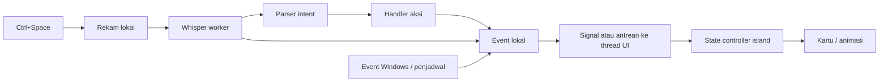

# Arsitektur dan data

> Cakupan aktif 0.3.0: lihat [16](16-kai-productivity.md). Clipboard/Command/Notes/Smart Shelf/Musik/Sistem; jam dan logo tetap. Fokus/Agenda/Waktu/Cuaca di bawah adalah arsip sumber, bukan fitur runtime aktif.

> Revisi aktif 22 Oktober 2026: lihat [15](15-redesain-island.md) untuk kaca charcoal, compositor native, kontrol child island, logo robot, Kai.exe dan Shelf screenshot otomatis. Desain navy/dialog di bawah merupakan baseline historis.

Status 22 Oktober 2026: modul aktif adalah main/island/panel (UI), intents/actions/events, storage (SQLite + scheduler), native (SMTC/Core Audio/notifikasi), integrations (cuaca/lirik/ICS/metrik). stt/speech_worker disimpan nonaktif. Panel diimpor/dibuat hanya saat dibuka. Integrasi OS hidup di thread; Qt menerima payload melalui queued signal. Tidak ada server/browser runtime.

**Keputusan terbaru:** suara nonaktif; entry point tidak memanggil stt/speech_worker. SMTC/Core Audio ada di desktop_worker.py, dimuat hanya selama Media aktif. tasks.py menjalankan integrasi lain dalam proses sesaat; proses ditutup dan tugas dibatalkan saat panel ditutup. Tujuannya melepas library native/layanan dari parent Qt, bukan menyembunyikan biaya helper. Bagian suara berikut mencatat implementasi sebelumnya yang kini nonaktif.

Whisper dan CUDA hanya diimpor di proses spawn per ucapan pada implementasi suara nonaktif. Parent memiliki satu SpeechJob; selesai/error/timeout/stop menutup proses. Pipe mengembalikan teks/metadata singkat, bukan objek model. PTT membuka stream saat ditahan dan menutup pada release/batas. Model di disk LOCALAPPDATA, bukan OneDrive. Guard RAM diperiksa sebelum import model.

Bagian struktur awal di bawah adalah rencana historis; nama modul usulan media.py/scheduler.py tidak dibuat karena tanggung jawabnya cukup di native.py/storage.py. Gunakan status 07 untuk bukti aktual.

## Pilihan teknologi

| Pilihan | Kesesuaian | Keputusan |
| --- | --- | --- |
| Python + PySide6 | Memakai ulang seluruh kerangka; integrasi suara langsung | Baseline sumber untuk versi awal |
| Python + C#/WPF-UI | Akses native UI Windows; dua runtime dan packaging lebih rumit | Opsional setelah pengukuran menunjukkan kebutuhan |
| Web UI + Python | Skill web lebih mudah dipakai langsung, tetapi menambah runtime dan jembatan OS | Tidak direkomendasikan untuk versi awal |

Jangan mengganti stack hanya demi efek visual. Prototipe harus membuktikan hit testing, fokus, DPI, dan animasi sebelum menambah blur.

## Struktur minimum

| Modul | Kondisi dan tanggung jawab |
| --- | --- |
| `kai/main.py` | Entry CLI yang ada; kelak memilih console/demo/UI dan mengatur shutdown |
| `kai/config.py` | Hotkey, audio, model, hint, aplikasi, Spotify sudah ada; tambahkan nilai UI terpusat jika dibutuhkan |
| `kai/intents.py` | Parser murni; tidak menyentuh UI/network/mikrofon |
| `kai/actions.py` | Handler aksi yang ada; pertahankan dahulu, pisahkan bagian hanya jika perubahan nyata menuntutnya |
| `kai/events.py` | Event bus lokal yang ada; adaptasi minimal untuk antrean/signal Qt |
| `kai/stt.py` | PTT dan transkripsi; penutupan stream dan serialisasi pekerjaan perlu diperbaiki |
| `kai/island.py` | Belum ada; jendela, bentuk, state controller, transisi, kartu awal |
| `kai/media.py` | Tambahkan pada tahap SMTC; session, metadata, timeline, kontrol |
| `kai/scheduler.py` | Tambahkan ketika persistensi/pause/restore dibangun; bukan satu threading.Timer per kebutuhan baru |
| Integrasi lain | Tambahkan hanya ketika milestone fitur tersebut dikerjakan |

Nama berkas tambahan adalah usulan, bukan scaffolding yang harus langsung dibuat. Jangan membangun lapisan abstraksi dengan satu implementasi.

## Alur runtime

Qt event loop berada di main thread. STT, jaringan, loading model, dan pembacaan sensor tidak boleh memblokir thread UI. Listener `events.emit()` sekarang dipanggil sinkron pada thread pengirim; jangan langsung mengubah widget dari listener worker. Jembatan queued Qt signal cukup; belum perlu WebSocket.

Usulan hanya satu pekerjaan transkripsi aktif. Rekaman baru ketika sibuk mendapat feedback, bukan menjalankan model yang sama lewat banyak thread. Tiap sesi memiliki ID agar hasil lama tidak menimpa state baru. Pada shutdown: hentikan hook keyboard, tutup audio, batalkan worker secara tertib, simpan state, hentikan sumber event.

Event yang ada hanya `kind`, `text`. Tambahkan payload terstruktur seperlunya untuk kartu: misalnya volume, mute, track ID, timer ID, waktu jatuh tempo. Jangan mengurai angka/status kembali dari teks manusia. `result` sukses dan error perlu dibedakan; saat ini `actions.run()` mengembalikan string “Gagal” melalui event result biasa.

## Sumber data dan penyegaran usulan

| Integrasi | Pengambilan dan interval awal | Penyimpanan/fallback |
| --- | --- | --- |
| Jam/tanggal | Tick sesuai tampilan, umumnya 1 detik | Tidak perlu database |
| Posisi kursor | Sampling hemat daya 30–60 ms untuk spike; ukur CPU idle | Tanpa hook penahan klik; kurangi jika perlu |
| Tema/accent | Baca awal dan event perubahan; fallback pembacaan jarang | Nilai default aman |
| SMTC | Event session/metadata/playback; interpolasi timeline lokal saat kartu terlihat | Cover cache terbatas; placeholder; pilih session aktif dengan jelas |
| Volume | Core Audio callback; deduplikasi update | Endpoint default bisa berganti; bind ulang |
| Headset | Event endpoint/perangkat; jangan samakan semua Bluetooth dengan headset | Nama dari OS; event reconnect tidak membanjiri |
| Whisper | On demand saat PTT; muat model di worker | Cache model lokal; CPU fallback bila CUDA gagal dimuat |
| Spotify | Hanya saat aksi; timeout dan penanganan rate limit | Media key/SMTC untuk transport dasar; tidak menggantikan pencarian lagu |
| Lirik | Fetch saat track berubah, sinkron timeline; cache berdasarkan track | Tidak tersedia jika lirik tidak ditemukan/offline |
| Sistem | Sekitar 1 detik saat panel terlihat; baterai/disk lebih jarang | Sensor tak tersedia ditandai, jangan invent data |
| Cuaca | Sekitar 15–30 menit; lokasi manual yang dikonfirmasi | Cache + waktu update; tandai stale/offline |
| Kalender | Impor `.ics` lokal saat file berubah atau refresh eksplisit | Zona waktu, recurrence, UID dan deduplikasi diperhitungkan |
| Timer/alarm | Satu penjadwal membaca deadline; tick UI terpisah | SQLite lokal; restore dan deduplikasi fire |
| Notifikasi | Event listener setelah izin/capability valid | Tampilkan saja; default tanpa riwayat isi pesan |

Polling di atas adalah usulan yang harus diukur, bukan semua dijalankan sejak startup. Hentikan render/polling panel tersembunyi yang tidak dibutuhkan. LHM membantu sensor GPU/suhu; psutil saja tidak menjamin seluruh sensor tersedia.

## Penyimpanan

Usulan `%LOCALAPPDATA%\Kai\` untuk settings pengguna, database SQLite, cache dan log terbatas; proyek sumber berada di OneDrive sehingga data pribadi sebaiknya tidak ikut folder proyek. Gunakan `sqlite3` bawaan Python untuk timer/alarm dan statistik Pomodoro. Jalur cache model mengikuti konfigurasi runtime yang nanti ditetapkan; jangan salin model besar ke Git/ZIP.

Data minimum penjadwal: ID, jenis, label, created time, due time berzona, durasi/sisa saat pause, state, dan tanda notifikasi selesai sudah dikirim. Simpan sebelum melaporkan berhasil. Setelah resume/restart, bandingkan deadline dengan waktu aktual; tampilkan kejadian terlewat sekali. SQLite tidak dapat membunyikan alarm saat proses tertutup atau mesin tidur. Dukungan bangun dari sleep melalui OS adalah cakupan terpisah yang perlu dipilih.

File shelf usulan paling sederhana menyimpan referensi path, bukan memindah/menghapus berkas asli. Path hilang menjadi item tidak tersedia. Mode salinan sementara, batas ukuran, pembersihan dan persistensi harus diputuskan sebelum implementasi.

Kalender usulan awal: impor read-only `.ics` + acara lokal untuk perintah tambah rapat. Ini belum dipilih pengguna. Menulis langsung ke Google Calendar memerlukan akses terpisah dan tidak disamakan dengan impor file.

## Privasi dan pemulihan

- Mikrofon aktif hanya selama PTT; batas 20 detik harus menutup stream, bukan sekadar berhenti menambah buffer. Audio mentah/transkrip tidak disimpan default.
- Tidak mengeksekusi shell dari hasil STT. Buka aplikasi memakai allowlist yang sudah ada; konfigurasi target tetap dianggap data tepercaya yang perlu validasi.
- Token OAuth disimpan lokal di luar sumber. Client ID bukan client secret; token tetap rahasia. Scopes mengikuti aksi yang benar-benar digunakan.
- Jaringan putus tidak boleh menghentikan jam, timer, UI, atau parser. Sediakan timeout dan feedback spesifik.
- Permission denied/sensor gagal/model gagal tidak boleh membuat seluruh island crash. CUDA gagal harus punya jalur CPU eksplisit; `pick_device()` saat ini belum menangani kegagalan konstruksi model setelah deteksi GPU.

## Pemeriksaan sumber resmi, 22 Oktober 2026

PKCE sesuai untuk aplikasi desktop tanpa secret. [Spotify PKCE](https://developer.spotify.com/documentation/web-api/tutorials/code-pkce-flow).

Development Mode saat pemeriksaan mensyaratkan Premium pemilik dan membatasi hingga lima pengguna. Uji endpoint pada Client ID pengguna sebelum menjanjikan seluruh aksi. [Spotify quota modes](https://developer.spotify.com/documentation/web-api/concepts/quota-modes). Pengumuman Maret menunda perubahan akses endpoint untuk integrasi lama; jangan menyamaratakan aturan app lama dan baru. [Spotify update](https://developer.spotify.com/blog/2026-02-06-update-on-developer-access-and-platform-security).

faster-whisper mendokumentasikan kebutuhan cuBLAS CUDA 12 dan cuDNN 9 pada jalur GPU terbaru; GPU terdeteksi bukan bukti library runtime tersedia. [README faster-whisper](https://github.com/SYSTRAN/faster-whisper).

Notification listener memerlukan capability manifest dan persetujuan pengguna. Jalur packaging/interop Python harus dibuktikan lewat spike sebelum dianggap siap. [Microsoft Notification listener](https://learn.microsoft.com/en-us/windows/apps/develop/notifications/app-notifications/notification-listener).
